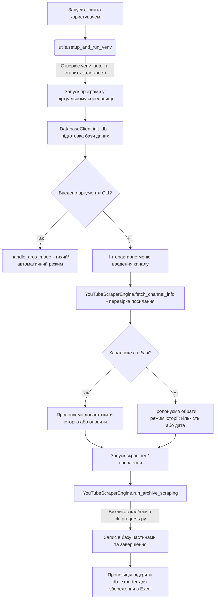

# 📊 YouTube Historical Scraper & DB Exporter

Ласкаво просимо! Цей проект створено для того, щоб допомогти вам легко збирати історію опублікованих відео з будь-яких YouTube-каналів, зберігати її в локальну базу даних SQLite, оновлювати статистику та вивантажувати результати у зручні Excel-таблиці або CSV-файли для подальшого аналізу.

Вся система спроектована так, щоб вам **не потрібно було вручну налаштовувати оточення Python або встановлювати складні залежності** — програма все зробить за вас автоматично при першому запуску!

---

## 📂 З чого складається проект (Структура файлів)

Проект розбито на кілька зрозумілих модулів, кожен з яких відповідає за свою задачу:

1.  **`init_db.py`** (Точка входу для збору історії)
    *   Головний скрипт, який ви запускаєте. Він запитує назву каналу та режим збору історії (наприклад, завантажити останні 500 відео чи всі відео після певної дати).
2.  **`update_db.py`** (Точка входу для оновлення статистики)
    *   Скрипт для швидкого оновлення бази даних. Він перевіряє канали в базі та дозавантажує лише найновіші відео, які з'явилися з моменту останнього збору. Використовує загальний двигун скрапера, тому повністю підтримує таймери, паузу та статистику.
3.  **`db_exporter.py`** (Точка входу для експорту)
    *   Скрипт, який вивантажує дані з локальної бази у красиві Excel/CSV файли.
4.  **`scraper_engine.py`** (Двигун для завантаження даних)
    *   "Мозок" збирача. Він запускає утиліту `yt-dlp` у фоні, зчитує інформацію про відео в режимі реального часу, формує зручний вигляд і передає її в базу даних.
5.  **`db_client.py`** (Робота з базою даних)
    *   Відповідає за створення таблиць та збереження відео й каналів. База даних зберігається в одному файлі `youtube_news.db` прямо у папці з проектом.
6.  **`cli_progress.py`** (Відображення прогресу та статистика)
    *   Модуль, що керує відображенням прогресу в консолі. Він відповідає за плавний таймер (з точністю до десятих частин секунди), обробку натискання клавіші Пробіл для паузи та виведення фінальної статистики часу збирання.
7.  **`utils.py`** (Корисні інструменти)
    *   Тут зібрані загальні функції: автоматичне створення віртуального середовища (`venv_auto`), очищення екрана консолі, красиве малювання меню та розпізнавання посилань на канали.
8.  **`keypress.py`** (Відстеження клавіш)
    *   Невеличкий модуль, який "слухає" натискання клавіші **Пробіл** під час завантаження історії, щоб ви могли в будь-який момент призупинити процес і відкрити меню керування.

---

## 🛠️ Як працюють ключові класи (Опис ООП архітектури)

Проект побудовано на основі **Об'єктно-Орієнтованого Програмування (ООП)**. Замість набору окремих функцій ми використовуємо три головні "об'єкти-помічники":

### 1. `DatabaseClient` (Клієнт бази даних)
*   **Де знаходиться:** `db_client.py`
*   **Для чого потрібен:** Керує локальною базою даних SQLite `youtube_news.db`.
*   **Що вміє робити:**
    *   `init_db()`: Перевіряє, чи створено таблиці `channels` (канали) та `videos` (відео), та створює їх за потреби.
    *   `add_or_update_channel(...)`: Додає назву каналу в базу або оновлює її, якщо канал вже відомий.
    *   `add_or_update_videos(...)`: Приймає список відео та записує їх у базу. Якщо якесь відео вже там є, оновлює його кількість переглядів, лайків та коментарів.
    *   `get_channel_stats(...)` та `get_channel_video_info(...)`: Отримує статистику по каналу (скільки відео в базі, період публікацій тощо).

### 2. `YouTubeScraperEngine` (Двигун скрапінгу)
*   **Де знаходиться:** `scraper_engine.py`
*   **Для чого потрібен:** Керує процесом отримання даних із YouTube.
*   **Що вміє робити:**
    *   `fetch_channel_info()`: Робить швидкий запит до YouTube для отримання офіційної назви та унікального ID каналу (наприклад, `UC...`).
    *   `run_archive_scraping(...)`: Запускає повний збір історії. Він завантажує дані частинами (пакетами по 50 відео) і зберігає в базу. Підтримує прапорець `stop_on_known=True` (для оновлювача) — у цьому режимі двигун миттєво зупиняє завантаження та вимикає підпроцес `yt-dlp` при виявленні першого вже збереженого відео, запобігаючи зайвій работе та зависанню.

### 3. `DataExporter` (Експортер таблиць)
*   **Де знаходиться:** `db_exporter.py`
*   **Для чого потрібен:** Перетворює сухі дані з бази в красиві звіти.
*   **Що вміє робити:**
    *   `get_channels_list()`: Отримує з бази список усіх раніше збережених каналів.
    *   `export_data(...)`: Зчитує відео з бази даних та зберігає їх у форматі **Excel (.xlsx)** або **CSV (.csv)**. Додатково додає в таблицю зручну колонку з прямими посиланнями на відео (можна клікнути і відкрити відео у браузері).

---

## 🔄 Як компоненти взаємодіють між собою (Життєвий цикл роботи)

Коли ви запускаєте програму, вона проходить наступний шлях:



---

## 🚀 Як користуватися програмою

Ви можете запускати програму двома способами: **інтерактивно** (через зручні діалоги та меню) або **через командний рядок** (ідеально для автоматизації).

### 1. Первинний збір історії каналу (`init_db.py`)

#### Інтерактивний режим:
Просто запустіть скрипт:
```bash
python3 init_db.py
```
Програма запитає у вас посилання на канал або його handle (наприклад, `@UATVEnglish` або просто назву `UATVEnglish`). Далі ви зможете обрати, скільки відео завантажити.

#### Режим командного рядка (CLI):
Ви можете передати всі параметри одразу при запуску:
```bash
python3 init_db.py [Канал] [Режим: 1 або 2] [Кількість або Дата]
```
*   **Режим 1** — Збір історії (лімітований кількістю відео). Третій параметр — кількість відео.
    ```bash
    # Зібрати останні 300 відео для каналу UATVEnglish
    python3 init_db.py UATVEnglish 1 300
    ```
*   **Режим 2** — Збір відео починаючи з конкретної дати. Третій параметр — дата у форматі `YYYYMMDD`.
    ```bash
    # Зібрати всі відео каналу UATVEnglish починаючи з 1 січня 2026 року
    python3 init_db.py UATVEnglish 2 20260101
    ```

💡 **Корисна фішка:** Під час скрапінгу ви можете натиснути клавішу **Пробіл**. Процес стане на паузу, збереже все завантажене на цей момент і покаже меню, де ви можете продовжити збір, змінити ліміт відео на ходу або вийти. Таймери оновлюються з точністю до **десятих часток секунди**.

---

### 2. Інкрементальне оновлення бази даних (`update_db.py`)

Коли ви вже маєте базу даних і хочете швидко довантажити свіжі відео (наприклад, ті, що вийшли сьогодні або вчора):
```bash
# Оновити всі канали в базі даних
python3 update_db.py

# Оновити конкретний канал
python3 update_db.py -c UATVEnglish
```
*   **Як це працює:** Якщо ви вкажете свій персональний `YOUTUBE_API_KEY` в системних змінних, програма оновлює базу миттєво через офіційне API. Якщо ключа немає — вона автоматично запустить швидкий скрапер для перших 20 відео, показуючи плавний прогрес-бар, таймер і дозволяючи натискати Пробіл для паузи так само, як при зборі історії!

---

### 3. Експорт результатів (`db_exporter.py`)

Щоб отримати готові дані у зручному для читання форматі:
```bash
python3 db_exporter.py
```
Програма покаже список усіх каналів у вашій базі та кількість збережених відео для кожного. Ви вводите номер потрібного каналу (або вибираєте експорт всіх каналів разом), обираєте формат (Excel / CSV) та отримуєте готовий файл, який програма запропонує одразу відкрити.

Для автоматичного експорту без діалогів (наприклад, по крону):
```bash
python3 db_exporter.py -a -f both --silent
```
*(де `-a` означає експортувати всі канали, `-f both` — зберегти у CSV та Excel одночасно, а `--silent` — без діалогових вікон).*

---

## 🗄️ Схема локальної бази даних SQLite (`youtube_news.db`)

Дані зберігаються у двох реляційних таблицях. Нижче наведено опис структури бази:

### Таблиця `channels` (Інформація про канали)
| Поле | Тип | Опис |
| :--- | :--- | :--- |
| `channel_id` | `TEXT` (Primary Key) | Унікальний ID YouTube-каналу (починається з `UC...`) |
| `channel_name` | `TEXT` | Назва каналу |
| `channel_handle` | `TEXT` | Нікнейм каналу з символом `@` (наприклад, `@UATVEnglish`) |
| `updated_at` | `TEXT` | Дата та час останнього оновлення запису в базі (YYYY-MM-DD HH:MM:SS) |

### Таблиця `videos` (Збережені відео)
| Поле | Тип | Опис |
| :--- | :--- | :--- |
| `video_id` | `TEXT` (Primary Key) | Унікальний ідентифікатор відео на YouTube (11 символів) |
| `channel_id` | `TEXT` (Foreign Key) | Зв'язок з таблицею `channels` |
| `title` | `TEXT` | Назва відео |
| `description` | `TEXT` | Повний текстовий опис відео |
| `published_at` | `TEXT` | Дата публікації відео (формат YYYY-MM-DD) |
| `duration` | `INTEGER` | Тривалість відео у секундах |
| `view_count` | `INTEGER` | Кількість переглядів на момент останнього скрапінгу |
| `like_count` | `INTEGER` | Кількість лайків |
| `comment_count` | `INTEGER` | Кількість коментарів |
| `tags` | `TEXT` | Теги відео через кому |
| `updated_at` | `TEXT` | Дата та час останнього оновлення відео в базі (YYYY-MM-DD HH:MM:SS) |

---

## 🛡️ Механізми обходу блокувань YouTube (Anti-Ban & Rate-Limiting)

Для стабільного збору великої кількості відео без використання API впроваджено комплексний захист:

1. **Динамічні пачки (8–12 відео)**: Замість завантаження всієї історії за один великий запит, скрипт викликає `yt-dlp` короткими випадковими пачками (від 8 до 12 відео за сесію). Це імітує поведінку користувача, який переглядає сторінку каналу порціями.
2. **Рандомізовані паузи (1.5–3.5с)**: Після кожної завантаженої пачки підпроцес `yt-dlp` повністю завершується, а Python робить паузу випадкової тривалості перед запуском наступної. Це перериває послідовність автоматичних мережевих запитів.
3. **Автоматичний кулдаун (40с)**: Якщо YouTube починає штучно затримувати відповіді (затримка більше 40 секунд на одне відео), програма:
   - Примусово зупиняє підпроцес `yt-dlp`.
   - Зберігає накопичений буфер відео в базу.
   - Витримує паузу **40 секунд** із візуальним зворотним відліком у консолі.
   - Автоматично перезапускає скрапер та продовжує роботу з того ж місця.
4. **Маскування клієнта**: Утиліті `yt-dlp` примусово передаються заголовки та параметри офіційних додатків YouTube: `--extractor-args "youtube:player-client=ios,web,android"`.

---

## 🔑 Конфігурація YouTube Data API v3

Для інкрементального оновлення за допомогою `update_db.py` рекомендується використовувати офіційне API, оскільки це найшвидший метод. 

Для цього встановіть змінну оточення `YOUTUBE_API_KEY`:
* **macOS / Linux**:
  Додайте рядок у ваш `~/.zshrc` або `~/.bashrc`:
  ```bash
  export YOUTUBE_API_KEY="ваш_ключ_api"
  ```
* **Windows (Command Prompt)**:
  ```cmd
  set YOUTUBE_API_KEY="ваш_ключ_api"
  ```
* **Windows (PowerShell)**:
  ```powershell
  $env:YOUTUBE_API_KEY="ваш_ключ_api"
  ```

---

## 📈 Системні вимоги та залежності

Вам потрібен лише встановлений **Python 3.8+**.
Всі необхідні бібліотеки будуть завантажені автоматично у відокремлену папку `venv_auto/` при першому ж запуску будь-кого з скриптів (також можна встановити їх вручну через `pip install -r requirements.txt`). Проект використовує:
*   `yt-dlp` — для завантаження інформації з YouTube.
*   `requests` — для роботи з YouTube API.
*   `pandas` та `openpyxl` — для створення Excel-звітів.
