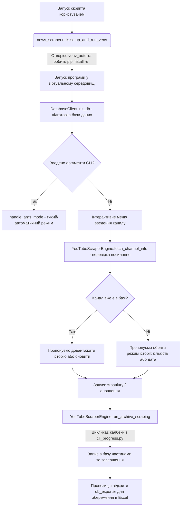

# 📊 YouTube Historical Scraper & DB Exporter

Цей модуль створено для того, щоб допомогти вам легко збирати історію опублікованих відео з будь-яких YouTube-каналів, зберігати її в локальну базу даних SQLite, оновлювати статистику та вивантажувати результати у зручні Excel-таблиці або CSV-файли для подальшого аналізу.

Вся система спроектована так, щоб вам **не потрібно було вручну налаштовувати оточення Python або встановлювати складні залежності** — програма все зробить за вас автоматично при першому запуску!

---

## 📂 З чого складається проект (Структура файлів)

Проект оформлено як структурований Python-пакет `news_scraper` з окремими точками входу в корені:

### Точки входу (у корені проекту)
1. **`init_db.py`** (Ініціалізація та збір історії)
   * Головний скрипт для запуску. Запитує назву каналу та режим збору історії (наприклад, завантажити останні 500 відео чи всі відео після певної дати).
2. **`update_db.py`** (Швидке оновлення)
   * Скрипт для дозавантаження найновіших відео для каналів, які вже є в базі.
3. **`db_exporter.py`** (Експорт звітів)
   * Скрипт, який вивантажує дані з локальної бази у Excel-таблиці або CSV-файли. Підтримує вивантаження ТОП-N відео за переглядами за допомогою прапорців `--top N` або `--topN`.

### Конфігураційні файли
4. **`pyproject.toml`**
   * Файл конфігурації пакету, який описує залежності (`yt-dlp`, `requests`) та дозволяє встановлювати проект у editable-режимі (`pip install -e .`).

### Пакет модулів (`news_scraper/`)
5. **`news_scraper/db_client.py`** (Клієнт бази даних)
   * Керує підключенням до SQLite (`youtube_news.db`), створенням таблиць та збереженням записів.
6. **`news_scraper/scraper_engine.py`** (Двигун скрапінгу)
   * Запускає `yt-dlp` у фоні, розбирає вивід, підтримує авто-кулдаун при тротлінгу та ручну паузу.
7. **`news_scraper/cli_progress.py`** (Візуалізація та інтерфейс)
   * Малює плавний таймер, обробляє меню пауз та виводить підсумкові звіти.
8. **`news_scraper/utils.py`** (Утиліти та бутстрапер)
   * Містить функції автоналаштування віртуального середовища (`venv_auto`), нормалізації посилань тощо.
9. **`news_scraper/keypress.py`** (Детектор клавіш)
   * Дозволяє неблокуюче відстежувати натискання Пробілу для паузи.

---

## 🛠️ Як працюють ключові класи (Опис ООП архітектури)

Проект побудовано на основі **Об'єктно-Орієнтованого Програмування (ООП)**. Основна логіка виділена у три класи всередині пакету `news_scraper`:

### 1. `DatabaseClient` (Клієнт бази даних)
* **Де знаходиться:** [db_client.py](file:///Users/oleksii/Documents/News%20Research%20Automation/news_scraper/db_client.py)
* **Для чого потрібен:** Керує локальною базою даних SQLite `youtube_news.db`.
* **Що вміє робити:**
  * `init_db()`: Створює таблиці `channels` та `videos`.
  * `add_or_update_channel(...)`: Зберігає метадані каналу.
  * `add_or_update_videos(...)`: Записує відео пачками (накопичуються в буфері скрапера).
  * `get_channel_stats(...)` та `get_channel_video_info(...)`: Отримує статистику по каналу.

### 2. `YouTubeScraperEngine` (Двигун скрапінгу)
* **Де знаходиться:** [scraper_engine.py](file:///Users/oleksii/Documents/News%20Research%20Automation/news_scraper/scraper_engine.py)
* **Для чого потрібен:** Керує запуском `yt-dlp` та збором інформації.
* **Що вміє робити:**
  * `fetch_channel_info()`: Отримує назву та ID каналу.
  * `run_archive_scraping(...)`: Запускає процес збору даних випадковими пачками (30-40 відео), робить випадкові паузи (5.5-8.5с) та запускає авто-кулдаун на 40 секунд у разі затримки.

### 3. `DataExporter` (Експортер таблиць)
* **Де знаходиться:** [db_exporter.py](file:///Users/oleksii/Documents/News%20Research%20Automation/db_exporter.py)
* **Для чого потрібен:** Перетворює дані з SQLite в Excel (.xlsx) або CSV.
* **Що вміє робити:**
  * `export_data(...)`: Експортує дані для обраного каналу або всіх каналів разом. Підтримує фільтрацію за переглядами (ТОП-N).

---

## 🔄 Як компоненти взаємодіють між собою (Життєвий цикл роботи)

Коли ви запускаєте програму, вона проходить наступний шлях:



---

## 🚀 Як користуватися програмою

Ви можете запускати програму двома способами: **інтерактивно** (через зручні діалоги та меню) або **через командний рядок** (ідеально для автоматизації).

### 1. Первинний збір історії каналу (`init_db.py`)

#### Інтерактивний режим:
Просто запустіть скрипт:
```bash
python3 init_db.py
```
Програма запитає у вас посилання на канал або його handle (наприклад, `@UATVEnglish` або просто назву `UATVEnglish`). Далі ви зможете обрати, скільки відео завантажити.

#### Режим командного рядка (CLI):
Ви можете передати всі параметри одразу при запуску:
```bash
python3 init_db.py [Канал] [Режим: 1 або 2] [Кількість або Дата]
```
*   **Режим 1** — Збір історії (лімітований кількістю відео). Третій параметр — кількість відео.
    ```bash
    # Зібрати останні 300 відео для каналу UATVEnglish
    python3 init_db.py UATVEnglish 1 300
    ```
*   **Режим 2** — Збір відео починаючи з конкретної дати. Третій параметр — дата у форматі `YYYYMMDD`.
    ```bash
    # Зібрати всі відео каналу UATVEnglish починаючи з 1 січня 2026 року
    python3 init_db.py UATVEnglish 2 20260101
    ```

💡 **Корисна фішка:** Під час скрапінгу ви можете натиснути клавішу **Пробіл**. Процес стане на паузу, збереже все завантажене на цей момент і покаже меню, де ви можете продовжити збір, змінити ліміт відео на ходу або вийти. Таймери оновлюються з точністю до **десятих часток секунди**.

---

### 2. Інкрементальне оновлення бази даних (`update_db.py`)

Коли ви вже маєте базу даних і хочете швидко довантажити свіжі відео (наприклад, ті, що вийшли сьогодні або вчора):
```bash
# Оновити всі канали в базі даних
python3 update_db.py

# Оновити конкретний канал
python3 update_db.py -c UATVEnglish
```
*   **Як це працює:** Якщо ви вкажете свій персональний `YOUTUBE_API_KEY` в системних змінних, програма оновлює базу миттєво через офіційне API. Якщо ключа немає — вона автоматично запустить швидкий скрапер для перших 20 відео, показуючи плавний прогрес-бар, таймер і дозволяючи натискати Пробіл для паузи так само, як при зборі історії!

---

### 3. Експорт результатів (`db_exporter.py`)

Щоб отримати готові дані у зручному для читання форматі:
```bash
python3 db_exporter.py
```
Програма покаже список усіх каналів у вашій базі та кількість збережених відео для кожного. Ви вводите номер потрібного каналу (або вибираєте експорт всіх каналів разом), обираєте формат (Excel / CSV) та отримуєте готовий файл, який програма запропонує одразу відкрити.

Для автоматичного експорту без діалогів (наприклад, по крону):
```bash
python3 db_exporter.py -a -f both --silent
```
*(де `-a` означає експортувати всі канали, `-f both` — зберегти у CSV та Excel одночасно, а `--silent` — без діалогових вікон).*

---

## 🗄️ Схема локальної бази даних SQLite (`youtube_news.db`)

Дані зберігаються у двох реляційних таблицях. Нижче наведено опис структури бази:

### Таблиця `channels` (Інформація про канали)
| Поле | Тип | Опис |
| :--- | :--- | :--- |
| `channel_id` | `TEXT` (Primary Key) | Унікальний ID YouTube-каналу (починається з `UC...`) |
| `channel_name` | `TEXT` | Назва каналу |
| `channel_handle` | `TEXT` | Нікнейм каналу з символом `@` (наприклад, `@UATVEnglish`) |
| `updated_at` | `TEXT` | Дата та час останнього оновлення запису в базі (YYYY-MM-DD HH:MM:SS) |

### Таблиця `videos` (Збережені відео)
| Поле | Тип | Опис |
| :--- | :--- | :--- |
| `video_id` | `TEXT` (Primary Key) | Унікальний ідентифікатор відео на YouTube (11 символів) |
| `channel_id` | `TEXT` (Foreign Key) | Зв'язок з таблицею `channels` |
| `title` | `TEXT` | Назва відео |
| `description` | `TEXT` | Повний текстовий опис відео |
| `published_at` | `TEXT` | Дата публікації відео (формат YYYY-MM-DD) |
| `duration` | `INTEGER` | Тривалість відео у секундах |
| `view_count` | `INTEGER` | Кількість переглядів на момент останнього скрапінгу |
| `like_count` | `INTEGER` | Кількість лайків |
| `comment_count` | `INTEGER` | Кількість коментарів |
| `tags` | `TEXT` | Теги відео через кому |
| `updated_at` | `TEXT` | Дата та час останнього оновлення відео в базі (YYYY-MM-DD HH:MM:SS) |

---

## 🛡️ Механізми обходу блокувань YouTube (Anti-Ban & Rate-Limiting)

Для стабільного збору великої кількості відео без використання API впроваджено комплексний захист:

1. **Динамічні пачки (30–40 відео)**: Замість завантаження всієї історії за один великий запит, скрипт викликає `yt-dlp` короткими випадковими пачками (від 30 до 40 відео за сесію). Це імітує поведінку користувача, який переглядає сторінку каналу порціями.
2. **Рандомізовані паузи (5.5–8.5с)**: Після кожної завантаженої пачки підпроцес `yt-dlp` повністю завершується, а Python робить паузу випадкової тривалості перед запуском наступної. Це перериває послідовність автоматичних мережевих запитів.
3. **Автоматичний кулдаун (40с)**: Якщо YouTube починає штучно затримувати відповіді (затримка більше 40 секунд на одне відео), програма:
   - Примусово зупиняє підпроцес `yt-dlp`.
   - Зберігає накопичений буфер відео в базу.
   - Витримує паузу **40 секунд** із візуальним зворотним відліком у консолі.
   - Автоматично перезапускає скрапер та продовжує роботу з того ж місця.
4. **Маскування клієнта**: Утиліті `yt-dlp` примусово передаються заголовки та параметри офіційних додатків YouTube: `--extractor-args "youtube:player-client=ios,web,android"`.

---

## 🔑 Конфігурація YouTube Data API v3

Для інкрементального оновлення за допомогою `update_db.py` рекомендується використовувати офіційне API, оскільки це найшвидший метод. 

Для цього встановіть змінну оточення `YOUTUBE_API_KEY`:
* **macOS / Linux**:
  Додайте рядок у ваш `~/.zshrc` або `~/.bashrc`:
  ```bash
  export YOUTUBE_API_KEY="ваш_ключ_api"
  ```
* **Windows (Command Prompt)**:
  ```cmd
  set YOUTUBE_API_KEY="ваш_ключ_api"
  ```
* **Windows (PowerShell)**:
  ```powershell
  $env:YOUTUBE_API_KEY="ваш_ключ_api"
  ```

---

## 📈 Системні вимоги та залежності

Вам потрібен лише встановлений **Python 3.8+**.
Всі необхідні бібліотеки будуть завантажені автоматично у відокремлену папку `venv_auto/` при першому ж запуску будь-кого з скриптів (також можна встановити їх вручну через `pip install -r requirements.txt`). Проект використовує:
*   `yt-dlp` — для завантаження інформації з YouTube.
*   `requests` — для роботи з YouTube API.
*   `pandas` та `openpyxl` — для створення Excel-звітів.
