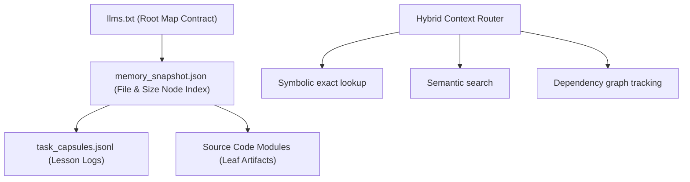

# Governed Autonomous Intelligence Workspace: Memory OS & SOLID Refactoring Architecture

## 1. SOLID Codebase Evaluation

We evaluated the core backend components, focusing on `AgentService` ([agent.py](file:///Users/oleksii/Documents/News%20Research%20Automation/app/services/agent.py)) and the SQLite client interface ([db_client.py](file:///Users/oleksii/Documents/News%20Research%20Automation/news_scraper/db_client.py)).

### 1.1 Single Responsibility Principle (SRP)
- **Violation**: `AgentService` is currently a God Class. It manages:
  1. DB context compilation (`build_dashboard_context`).
  2. Prompt composition (`_build_system_prompt`).
  3. Quota/provider rotation state tracking (`_get_rotation_attempts`, `_is_quota_error`).
  4. Stream connections to multiple APIs (`_stream_provider_text` for Gemini, OpenRouter, Ollama, OpenAI).
  5. SQLite chat logging (`_log_chat`).
- **Refactoring Target**: Extract distinct single-purpose services:
  - `SystemPromptBuilder`: Compiles dashboard metrics into context strings.
  - `LLMOrchestrator`: Entry route that calls rotation and client engines.
  - `QuotaRotationEngine`: Evaluates retry loops and provider failure metrics.
  - `ChatLogger`: Encapsulates chat audit writes to SQLite.

### 1.2 Open/Closed Principle (OCP)
- **Violation**: `AgentService._stream_provider_text` relies on hardcoded `if/elif` branches to format payloads for different providers. Adding a new provider requires editing the core streaming method.
- **Refactoring Target**: Introduce an abstract client interface `BaseLLMClient` with a method `stream_chat(...)`. Provide concrete subclasses (`GeminiClient`, `OpenRouterClient`, `OllamaClient`, `OpenAIClient`). The orchestrator will dynamically resolve the client via a factory registry, making it open to extension and closed to modification.

### 1.3 Liskov Substitution Principle (LSP)
- **Status**: Generally clean. However, the orchestrator must guarantee that all concrete `BaseLLMClient` implementations return standard chunk structures yielding identical token-usage metadata, exception structures, and chunk generators without downstream side-effects.

### 1.4 Interface Segregation Principle (ISP)
- **Violation**: `BaseStorage` in `db_client.py` has grown into a wide interface forcing all persistence clients to implement channel collection, video updates, sync markers, and stats queries simultaneously.
- **Refactoring Target**: Segregate the wide interface into specific repository interfaces:
  - `IChannelRepository`: Handles channel registration, handles, and avatars.
  - `IVideoRepository`: Handles caching, updates, and descriptions.
  - `ISyncCoordinator`: Manages Neon/cloud delta markers.

### 1.5 Dependency Inversion Principle (DIP)
- **Violation**: `AgentService` instantiates a concrete `DatabaseClient` directly and reads global `.env` keys inside methods. It depends on concrete implementations and environment details rather than abstractions.
- **Refactoring Target**: Inject `BaseStorage` interface and provider api keys via constructor injection.

---

## 2. Memory OS Architecture Specification

To optimize agent context retrieval and control token consumption, the project's memory is structured as a hierarchical **Memory OS**:



### 2.1 Layer 1: Root Map Contract (`llms.txt`)
- **Location**: `/Users/oleksii/Documents/News Research Automation/llms.txt`
- **Format**: Curated Markdown designed specifically for LLMs. It maps key entry points, blueprint routers, DB layers, and styling configurations. It prevents agents from scanning directories blindly.

### 2.2 Layer 2: Hierarchical Memory Nodes (`memory_snapshot.json`)
- **Location**: `agent_context/memory_snapshot.json`
- **Format**: JSON manifest regenerated via `scripts/compact_memory.py`.
- **Purpose**: Tracks SHA-256 hashes, class/function exports, layer boundaries (`meta-layer`, `domain-layer`, `telemetry-layer`), and direct file dependencies.

### 2.3 Layer 3: Experience Memory (`task_capsules.jsonl`)
- **Location**: `agent_context/task_capsules.jsonl`
- **Format**: Append-only JSON Lines.
- **Payload**:
  ```json
  {
    "timestamp": "2026-06-01T22:00:00Z",
    "task": "Sidebar responsive overlay integration",
    "files_modified": ["static/css/style.css", "static/js/app.js"],
    "hurdles_regression": "Double event dispatch on mobile click-outside toggle buttons",
    "resolution": "Check e.target.closest('.sidebar-brand-toggle') in listener",
    "lessons_learned": "Never trigger click-outside events for toggle controls that possess native toggle event listeners."
  }
  ```

### 2.4 Hybrid Retrieval Routing
- **Symbolic Router**: Leverages standard paths, imports, and `llms.txt` symbols for exact-match retrieval.
- **Semantic Router**: Uses vector similarity (e.g., LlamaIndex RAG) for open-ended queries ("how does quota rotation work?").
- **Dependency Router**: Traces imports to query all files within a module's blast radius during modifications.

### 2.5 Tool-First Execution Policy
- Agents are prohibited from guessing system state, database layouts, or syntax validity.
- **Execution Rule**: Always run python compilation checks (`compileall`), test runs (`unittest`), or database diagnostics before reporting completed tasks to the user.

---

## 3. User-Facing Memory OS (User-OS) Subsystem

The User-OS subsystem runs within the analytical dashboard and the streaming chat assistant. It is designed to let the end-user train the AI co-editor without exposing the product's internal code architecture.

### 3.1 Database Schema
User memories are stored in an isolated SQLite database at `data/memory_os.db` (governed by the `MemoryOS` client in `app/services/memory_os/core.py`).
- **`memories` Table**:
  * `id`: unique text identifier for the memory chunk.
  * `type`: class of memory (e.g. `fact`, `preference`, `alert_rule`, `narrative_link`).
  * `content`: raw text details of the memory.
  * `summary`: short user-inspectable title or explanation.
  * `importance`: real value between 0.0 and 1.0 (used for context ranking in prompts).
  * `timestamp`: epoch integer for freshness tracking.

### 3.2 Context Ingestion Flows
End-users can ingest analytical data from the dashboard to train Memos using two paths:
1. **Explicit UI Action (Widget "Save" / "Teach")**: Single-click triggers on Compact Grid widgets, anomalies cards, or generated daily briefs compile localized markdown summaries and persist them into the `memories` table.
2. **Conversational Chat Extraction**: The user instructs the co-editor to "remember" an analytical insight during chat stream interactions. The assistant parses the active filters (channels, date presets, selected anomalies) and saves the summary using `add_or_update_memory`.

### 3.3 Context Retrieval & Prompt Gating
When executing streaming chat via `AgentService`:
1. **No Codebase Leaks**: Dev-OS files (flat-file JSONLs, snapshots, CLI logs) are completely blocked from User-OS prompt building.
2. **Dynamic Ranking**: Retrieve relevant memories from `data/memory_os.db` filtered by type and sorted by `importance DESC, timestamp DESC`.
3. **Context Injection**: Format memories as clean YAML block quotes inside prompt context sections, allowing the LLM co-editor to draw on user-defined facts, narrative links, and alerting preferences.

