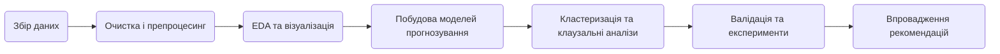
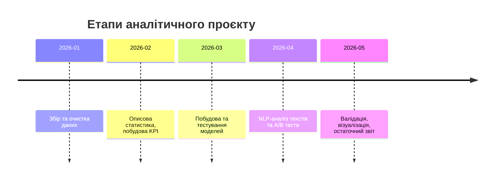

# Виконавчий підсумок  
Для аналізу великого набору даних YouTube-каналу пропонується **повний аналітичний звіт**: починаючи з підготовки даних, описової статистики та візуалізації ключових метрик, аж до побудови прогнозних моделей і оцінки впливу текстових факторів (n-грам) у заголовках/описах. Ми опишемо **інструментарій** (Python/R, BigQuery/SQL/Spark, BI-інструменти, бібліотеки для ML/NLP), повний набір **KPI та формул** їх розрахунку, а також **статистичні методи і моделі** (ARIMA/Prophet, регресії, survival-аналіз, каузальний аналіз, uplift-моделювання, A/B-тестування, multi-armed bandit тощо). Окремо розглянемо **обробку тексту і n-грам** (tokenization, TF-IDF, embeddings, topic modelling, BERT) для визначення їх ефекту на метрики (від CTR до часу перегляду) з прикладами коду та статистичних тестів. Будуть надані рекомендації з **feature engineering** (часові ознаки, сезонність, категорії, коефіцієнти, швидкості росту тощо) та **відбору фіч** (LASSO, важливість дерев, RFE). Усі моделі проходитимуть **перехресну валідацію і backtesting** із відповідними метриками якості (RMSE, MAE, AUC, lift тощо). Наведемо практичні **підходи і кейси** (кластеризація відео/аудиторії, cohort-аналіз, воронки конверсій, виявлення аномалій, оцінка впливу ескізів/назв, оптимізація контент-календаря та дорожня карта експериментів). Для візуалізації продемонструємо рекомендовані графіки (ретеншин-крива, CTR по часу, тренди, тощо), а також покажемо приклади приладових панелей і використання Mermaid для timeline або flowchart проєкту.

## 1. Збір та підготовка даних  
- **Джерела і експорт:** Використовувати YouTube Data/Analytics API або BigQuery (якщо є публічний доступ до даних за каналом) для отримання переглядів, лайків, коментарів, передплатників, Impressions, CTR, часу переглядів, заголовків, описів, дат публікації та інших метрик.  
- **Чищення даних:** У Python/Pandas (або SQL) прибираємо дублі, обробляємо відсутні значення (наприклад, нульові перегляди, які можуть бути результатом помилок), приводимо дати до єдиного формату. Переконайтесь, що усі числові поля числові, а текстові – коректно кодуються (UTF-8). Фільтруємо «спамні» коментарі/виклики (якщо є).  
- **Нормалізація тексту:** У заголовках/описах виконуємо токенізацію та нормалізацію (наприклад, нижній регістр, видалення пунктуації), видаляємо стоп-слова (за допомогою `nltk`/`spaCy` з підтримкою відповідної мови). Лемматизація (доречна, якщо потрібна узагальненість).  
- **Структуризація:** Якщо дані зберігаються у “wide” форматі, трансформуйте їх в “tidy” (одна стрічка = одне спостереження, наприклад, один рядок – відео з усіма полями). Для великих обсягів (десятки мільйонів записів) розгляньте Spark (PySpark) або BigQuery для обробки, а Pandas – для зразкової роботи.  

## 2. Описова статистика та візуалізація  
- **Загальні візуалізації:** Побудуйте розподіли (гістограми) за основними числовими метриками: `views`, `likes`, `comments`, `watch_time` тощо, а також боксплоти (для виявлення викидів) і діаграми розсіяння (наприклад, `views` vs `likes`, або `views` vs `watch_time`) для попередньої оцінки кореляцій.  
- **Тренди за часом:** Лінійні діаграми `views`/`watch_time` по датах, графіки сезонності (перегляди за днями тижня/місяцями). Можна використовувати `seaborn.lineplot`, `matplotlib` чи інтерактивні Plotly-діаграми. Це дозволить побачити тренди зростання або сезонні піки (наприклад, збільшення переглядів у вихідні чи під час свят).  
- **Динамічна візуалізація:** Дашборд у Looker/Tableau (або навіть Google Data Studio) з основними графіками: часовими рядами переглядів/часу, середньою тривалістю перегляду, CTR, конверсіями (підписки), взаємодією (лайки/коментарі). Використовуйте інтерактивні фільтри (по категоріям відео, даті тощо).  
- **Приклад візуалізації:** Наприклад, діаграма **розподілу переглядів за типом пристрою** демонструє, що ~63% переглядів надходять з мобільних пристроїв. Такий графік допомагає зорієнтуватися, як платформа/пристрій впливає на метрики:  
   *Рисунок:* **Приклад:** розподіл переглядів за типом пристрою (Mobile ~63%, Desktop ~12% тощо).  
- **Кореляції:** Розрахуйте матрицю кореляцій (за значеннями `views`, `likes`, `comments`, `watch_time`, CTR тощо) – візуалізуйте її теплограмою `seaborn.heatmap`. Це дає змогу виявити сильні лінійні залежності: наприклад, між часом перегляду та переглядами/лайками. Але пам’ятайте: кореляція ≠ причинність.

## 3. Метрики (KPI) та формули  
Набір ключових показників ефективності (KPI) повинен бути повним:  

- **Перегляди (Views):** загальна кількість відтворень відео.  
- **Час перегляду (Watch Time):** сумарний час (години) переглядів. Високий Watch Time дуже важливий для алгоритму YouTube, бо сигналізує про залученість.  
- **Середня тривалість перегляду (Average View Duration):** загальний час перегляду у секундах, поділений на кількість відтворень. Формула:  
  \[
    \text{Avg View Duration (сек)} = \frac{\text{Watch Time (сек)}}{\text{Views}}.
  \]  
- **Середній відсоток перегляду (Average % Viewed):** це відношення середньої тривалості перегляду до повної тривалості відео, у відсотках. Вимірює, яка частина відео в середньому дивляться. (YouTube надає у звітах).  
- **CTR (Click-Through Rate):** частка показів ескізу, що призводять до кліків. Формула:  
  \[
    CTR = \frac{\text{Clicks}}{\text{Impressions}} \times 100\%.
  \]  
  **Приклад:** YouTube визначає це як долю кліків по ескізу з усіх показів. Типові значення – від 2% до 10%. CTR – ключ до оцінки ефективності заголовка та ескізу.  
- **Коефіцієнт утримання аудиторії (Audience Retention):** показує, який відсоток глядачів залишився на кожній хвилині відео. Це зводиться до двох метрик: абсолютного retention (відсоток на кожному моменті) і відносного (порівняно з іншими відео аналогічної довжини).  
- **Лайки/Дизлайки, Коментарі:** суми відповідних реакцій. Зазвичай розраховують **Like rate** = Likes/Views, **Comment rate** = Comments/Views, **Share rate** і т.д. Вони показують залученість (engagement).  
- **Конверсії підписників:** приріст і відтік підписників (`subscribers_gained`, `subscribers_lost` – згідно з API). **Net Subscriptions** = gained – lost.  
- **Джерела трафіку:** долі переглядів з пошуку, рекомендованих, соціальних мереж тощо – дозволяє оптимізувати стратегію просування.  
- **Revenue (якщо є):** дохід за оглядами (RPM, total_revenue) – важливий для монетизованих каналів.  
- **Відношення Like/Dislike:** індикатор сприйняття контенту.  
- **Статус відео:** Long term metrics – підсумкове утримання, лояльність (ретеншн), показники зворотного зв’язку.  

Всі ці метрики можна обчислити як прості функції агрегованих даних. Наприклад, згідно з офіційним Reporting API, метрика `video_thumbnail_impressions_ctr` – це саме “Clicks/Impressions”. 

## 4. Статистичні моделі та методи  
### 4.1. Часові ряди  
Для прогнозування переглядів/часу перегляду у майбутньому зважаємо часові залежності:  
- **ARIMA/SARIMA/SARIMAX:** використовуються, якщо ряди мають авторегресію, тренд і сезонність. ARIMA (ARMA з інтегруванням) прогнозує на основі лише попередніх значень та помилок, SARIMA додає сезонність (день/тиждень, місяць), SARIMAX дозволяє включати зовнішні регресори (наприклад, кількість відвантажень відео, рекламні кампанії). Підходить для даних із стабільною циклічністю. Оцінюють якість за AIC/BIC, RMSE, MAE.  
- **Prophet:** бібліотека від Facebook (Meta) для сезонних часових рядів з нерегулярними імпульсами (наприклад, викиди чи святкові ефекти). Легко обробляє пропуски й тренди. Добре працює з добовою/тижневою сезонністю, пропонує інструменти розкладу трендів і додавання регрессорів.  
- **Holt-Winters (експоненційне згладжування):** для простих сезонних рядів (коли тренд/сезонність постійні).  
- **Deep Learning (LSTM, RNN):** можливі для дуже складних залежностей, але потребують багато даних. За потреби можна розглядати LSTM для довгих часових залежностей.  
- **Оцінка:** метрики прогнозування – RMSE, MAE, MAPE тощо. Для часових рядів також критерієм є адекватність залишків (відсутність автокореляції, нормальність розподілу).

### 4.2. Регресійні моделі  
- **Лінійна регресія:** прогнозування чисельних показників (наприклад, views, watch_time) через лінійну комбінацію фіч. Підходить за нормальних умов (якщо припущення лінійності та нормальних залишків близькі до істини). Використовують `statsmodels.OLS` чи `sklearn.linear_model.LinearRegression`.  
- **Poisson/Negative Binomial регресія:** оскільки `views`, `likes`, `comments` – лічильні дані, варто застосовувати регресію для count-даних. Poisson підходить, якщо середнє ≈ дисперсія; якщо є overdispersion (дисперсія >> середнє), краще Negative Binomial. У Python можна використати `statsmodels.GLM(family=Poisson())` або `GLM(family=NegativeBinomial())`. Наприклад:  
  ```python
  import statsmodels.api as sm
  model = sm.GLM(y_counts, X_features, family=sm.families.Poisson()).fit()
  print(model.summary())
  ```  
- **Логістична регресія:** для двійкових цілей, наприклад, моделювання ймовірності, що CTR буде вище певного порогу або відео стане «вірусним».  
- **Змішані ефекти (Mixed-Effects) моделі:** коли є ієрархічна структура (наприклад, повторювані виміри по тим самим темам/категоріям або різним каналам). Містять фіксовані ефекти (наприклад, тривалість відео) і випадкові (наприклад, випадкова зміна по каналу/тезі). (Python: `statsmodels.MixedLM` або `lme4` у R).  
- **Оцінка ефективності:** R², скоригований R² (для лінійної), AIC/BIC для порівняння моделей, а також валідація за RMSE/MAE на відкладеній вибірці.  

### 4.3. Survival-аналіз (утримання глядачів)  
- **Задача:** оцінити час, протягом якого глядач дивиться відео, як подію (наскільки довго “виживає” на початку). Можна застосувати survival-аналіз до часу до “відпаду” глядача.  
- **Методи:** Kaplan–Meier – для побудови кривих виживання (утримання) за виявленими подіями (припинення перегляду на певній хвилині). Cox Proportional Hazards Model дозволяє врахувати ознаки відео (напр., тривалість, категорія) як пояснювальні змінні – виходить модель ризику відпаду.  
- **Практика:** Використати бібліотеку `lifelines` у Python або `survival` у R. Наприклад, будувати криву виживання та перевіряти, наскільки певні характеристики відео суттєво зменшують hazard відпаду (зіставлення по ратио hazard). Метрики: log-rank тест для порівняння груп, concordance index.  

### 4.4. Каузальний аналіз (Causal Inference)  
- **DiD (Difference-in-Differences):** аналіз впливу інтервенцій (наприклад, зміни стратегії, запуск реклами, зміна іконки/назви) на метрики. Вибирають «контрольну» та «оброблену» групи відео/дат: до/після зміни. Приклад: порівняти зміни середніх CTR у відео, де оновили ескіз, та у тих, де не змінювали.  
- **IV (інструментальні змінні):** якщо існує зовнішній фактор, який впливає на використання «лікування» (наприклад, участь у рекомендаційній стрічці) та корелює з метрикою лише через цей канал. Наприклад, випадкові алгоритмічні раціоналізації можуть слугувати IV.  
- **PSM (Propensity Score Matching):** підбір контрольної групи відео за характеристиками (категорія, тривалість, попередня популярність), щоб порівнювати схожі об’єкти, які отримали/не отримали «лікування» (напр., зміна тега чи ескізу).  
- **Uplift-моделювання:** схоже на DiD, але зосереджується на побудові моделі, яка прогнозує *різницю* у реакції на ту чи іншу версію (тест/контроль). Наприклад, модель Uplift вивчає, як різні назви чи аудиторії викликають зміну CTR чи конверсії. Інструменти: пакети `causalml`, `econml`. Метрики: AUUC (Area Under Uplift Curve) або Qini-коефіцієнт.  
- **A/B тестування:** традиційне поділення трафіку на групи. На практиці YouTube навіть пропонує вбудований інструмент A/B-тестування назв та ескізів (до 3 варіантів) – виграє той, у якого більше часу перегляду. В дизайні враховуйте розмір вибірки (power analysis), тривалість експерименту (зазвичай до двох тижнів) та статистичні тести (t-тест для середніх часу перегляду або χ²-тест для пропорцій).  
- **Multi-Armed Bandit:** для одночасного експериментування кількох варіантів (наприклад, різних заголовків) з поступовим приділенням більшого трафіку успішнішим варіантам. Впроваджують політики Епсилон-жадібного відбору або байєсівський підхід (Thompson Sampling). Це оптимізує CTR в реальному часі без тривалого тестування.  

### 4.5. Приклади реалізації  
- **ARIMA-прогноз (Python):**  
  ```python
  import pandas as pd
  from statsmodels.tsa.arima.model import ARIMA

  data = pd.read_csv("youtube_views_timeseries.csv", index_col="date", parse_dates=True)
  ts = data['views']
  model = ARIMA(ts, order=(1,1,1)).fit()
  forecast = model.get_forecast(steps=30)
  print(forecast.summary_frame())
  ```
- **Лінійна/Poisson регресія (Python):**  
  ```python
  import statsmodels.api as sm
  X = df[['video_length','num_tags','is_trending']]  # приклад фіч
  y = df['views']
  lin_mod = sm.OLS(y, sm.add_constant(X)).fit()
  poi_mod = sm.GLM(y, sm.add_constant(X), family=sm.families.Poisson()).fit()
  print(lin_mod.summary())
  ```
- **Кохортний аналіз:** графік «кохортів» – час життя користувачів чи відео, наприклад, retention першого перегляду за місяцем публікації.

## 5. NLP та n-грами (заголовки й описи)  
- **Підготовка тексту:** для заголовків і описів застосуємо класичні методи NLP: токенізація (наприклад, `spaCy` з моделлю для укр/англ), приведення до нижнього регістру, видалення стоп-слів (переважно мови, якою написані тайтли). Лемматизація (корінь слова) або стемінг може допомогти звести різні форми слова.  
- **n-грами та TF-IDF:** зібравши корпус заголовків/описів, створимо набір n-грам (unigrams, bi-grams, tri-grams) за допомогою `sklearn.feature_extraction.text.CountVectorizer` або `TfidfVectorizer`. TF-IDF (term frequency–inverse document frequency) допомагає знизити вагу надзвичайно частих слів і виділити значущі фрази:  
  ```python
  from sklearn.feature_extraction.text import TfidfVectorizer
  corpus = df['title'].astype(str) + " " + df['description'].astype(str)
  vectorizer = TfidfVectorizer(ngram_range=(1,2), stop_words='english', max_features=1000)
  X_text = vectorizer.fit_transform(corpus)
  ```
- **Word Embeddings:** для глибшого контексту можна використовувати вбудовані моделі: Word2Vec чи GloVe для отримання векторів слів, або новітні трансформери (BERT, GPT і т.п.) через `transformers` (Hugging Face) для контекстних ембеддингів заголовків/описів. Це дозволить застосувати, наприклад, тональність або вкладення контенту у моделі регресії/класифікації.  
- **Topic Modelling:** Latent Dirichlet Allocation (LDA) у бібліотеці Gensim для виділення тем відео на основі описів. Це дає змогу згрупувати відео за прихованими категоріями (наприклад, навчальні, розважальні, оглядові і т.д.) і оцінити вплив тематики на метрики.  
- **Аналіз n-грам:** щоб оцінити, як конкретні слова/фрази впливають на результати, використовуємо експерименти та моделювання:  
  - **Експериментальний підхід:** A/B-тестування різних варіантів заголовків або модуляція ключових слів у описі, щоб виміряти зміну CTR/переглядів.  
  - **Регресійний аналіз з контролем:** включаємо бінарні ознаки “содержить слово *X*” у нашу регресійну модель, контролюючи інші фактори. Коефіцієнт при такій змінній покаже умовну зміну метрики.  
  - **SHAP / Feature Importance:** навчаємо дерево-рішення або градієнтний бустинг на TF-IDF-фічах і використовуємо SHAP або вбудовану важливість ознак, щоб зрозуміти, які n-грами найбільше впливають на передбачення CTR чи часу перегляду.  
  - **Статистичні тести:** наприклад, χ²-тест незалежності для виявлення асоціації між наявністю певного слова в заголовку і високим CTR, або пермутаційний тест на відмінність середніх CTR у групах відео з цією фразою і без неї.  
  - **Normalized Metrics:** наприклад, вимірювати *views per impression* у присутності/відсутності фрази, потім порівнювати розподіли (t-test чи U-тест Манна–Уїтні).  
- **Приклад коду (TF-IDF + регресія):**  
  ```python
  # Підготовка TF-IDF матриці
  vectorizer = TfidfVectorizer(ngram_range=(1,2), stop_words='english', max_features=500)
  X_text = vectorizer.fit_transform(df['title'])
  # Додаємо інші числові фічі
  X_other = df[['video_duration', 'num_tags', 'published_dayofweek']].to_numpy()
  from scipy.sparse import hstack
  X_all = hstack([X_text, X_other])
  y = df['ctr']  # процент
  # Модель регресії
  from sklearn.linear_model import LinearRegression
  model = LinearRegression().fit(X_all, y)
  coef = model.coef_
  # Визначаємо топ-5 n-грам з найбільшим коефіцієнтом
  top_indices = sorted(range(len(coef)), key=lambda i: coef[i], reverse=True)[:5]
  top_features = [(vectorizer.get_feature_names()[i], coef[i]) for i in top_indices]
  ```  
- **Перевірка ефективності:** розділіть дані на train/test за часом (наприклад, усі відео до певної дати – тренувальні, після – тестові), щоб перевірити прогностичну силу текстових моделей (MAE, R² для регресії CTR/VAAD).

## 6. Feature Engineering та відбір ознак  
- **Часові ознаки:** день тижня, година дня, місяць, сезонність. Наприклад, `published_hour = df['publish_date'].dt.hour`, `is_weekend = (weekday>=5)`.  
- **Сезонні події:** свята (національні, релігійні) чи важливі дати можуть впливати на трафік. Додайте булеві фічі або числові (відстань до найближчого свята).  
- **Категорії відео:** жанр/категорія (Music, Gaming тощо) як one-hot або target-encoding.  
- **Тривалість:** `duration_minutes`. Можливо, взаємодія duration*CTR (довші відео зазвичай мають менший retention%).  
- **Теги:** кількість тегів або конкретні популярні теги як фічі.  
- **Співвідношення:** `like_rate = likes/views`, `comment_rate = comments/views` як додаткові релевантні фічі.  
- **Швидкість росту:** фічі на кшталт `views_in_first_24h / 24` або пропорція переглядів за перший день до загальних.  
- **Взаємодія з іншими відео (network effects):** можна побудувати матрицю суміжності рекомендованих відео чи на основі метаданих (спільні ключові слова) та створити мережеві показники (центральність каналу тощо).  
- **Отримання динамічних ознак:** наприклад, трендовість теми (Google Trends за ключовими словами відео), або попередні перегляди каналу в день.  
- **Відбір ознак:**  
  - **Regularization (LASSO, Ridge):** дозволяє обирати релевантні з великої кількості фіч, занулюючи неінформативні.  
  - **Дерева (Random Forest, XGBoost):** дивимось властивість важливості фіч (feature_importances_).  
  - **Recursive Feature Elimination (RFE):** поступове відсікання найменш важливих ознак на основі моделі (наприклад, `RFE(estimator=RandomForestRegressor(), n_features_to_select=10)`).  
  - **Cross-Validation:** оцінювати якість моделі при різних наборах ознак та вибирати оптимальні.  

## 7. Валідація і оцінка моделей  
- **Підхід до розбиття:**  
  - Для часових рядів та прогнозів – *time-series cross-validation* (наприклад, блокове перекриття, walk-forward validation).  
  - Для звичайних моделей – train/test split за часом: моделюємо на старіших даних, тестуємо на новіших, щоб уникнути «витоку майбутньої інформації».  
- **Метрики:**  
  - **Регресія:** RMSE, MAE для безпосереднього прогнозу чисел (views, CTR, watch_time). R² для пояснювальної сили моделі.  
  - **Класифікація:** AUC-ROC, log-loss, precision/recall (якщо, наприклад, класифікуємо «вірусне/невірусне»). Lift (для оцінки підвищеної конверсії при таргетуванні на топ%).  
  - **Causal Impact:** статистична значущість (p-value), довірчі інтервали для оцінки впливу інтервенції.  
  - **Uplift:** AUUC (Area Under Uplift Curve) або Qini, які вимірюють перевагу моделі цільового таргетингу над випадковим розподілом.  
- **Backtesting:** імітуємо використання моделі на історичних даних, «вирішуючи» на основі моделі і порівнюємо з реальними результатами (наприклад, імітація, якби ми оновили ескіз відео/заголовок на момент релізу і бачили б приріст переглядів).  
- **Калібрування:** якщо модель видає ймовірності (напр., ймовірність високого CTR), перевіряємо калібрування за допомогою калібрувальних кривих (reliability diagrams).  

## 8. Практичні аналітичні підходи та кейси  
- **Кластеризація:** наприклад, k-means чи ієрархічна кластеризація відео за метриками (views, watch_time, duration, CTR) або за фічами (комбінація числових і текстових). Кластери можуть відповідати «вірусним роликам», «довгим аналітичним», «клаймексним» тощо. Це допомагає знайти приховані групи контенту та налаштувати стратегії для кожної.  
- **Кластеризація аудиторії:** якщо є дані по глядачах (гео, демо), то кластерізуйте користувачів за поведінкою (чи люблять коментувати, які теми дивляться).  
- **Cohort-аналіз:** групування глядачів чи відео за періодом (напр. місяць релізу) і відстеження метрик з часом. Наприклад, чи краща утримуваність глядачів, які почали підписуватися влітку, порівняно з іншими когорти.  
- **Воронка (Funnel) аналітика:** модель переходів: від імпресії (враження ескізу) до перегляду, від перегляду до лайку/підписки. Проаналізуйте “вузькі місця”: чи проблема в низькому CTR чи в поганій утримуваності після кліку?  
- **Виявлення аномалій:** пошук раптових стрибків/падінь у переглядах чи CTR – можуть сигналізувати про вірусність або технічні проблеми. Методи: сезонне розкладання (`statsmodels.tsa.seasonal_decompose`) + виявлення позанормових залишків, або алгоритми (Isolation Forest на часових даних).  
- **Кейс: вплив ескізів/заголовків:** наприклад, використати Google CausalImpact (R чи Python) для оцінки, чи змінився CTR після редизайну мініатюри, контролюючи автоколекцію.  
- **Оптимізація контент-календаря:** прогнозування найкращого часу/дня для публікацій на основі аналізу попередніх даних (когорт, сезон, з огляду на активність аудиторії).  
- **Дорожня карта експериментів:** систематизуйте експериментальний підхід: наприклад, A/B-тести міняють один елемент (ескіз, опис, заклик до дії) за раз, мультиваріантне тестування, далі – масштабування успішних змін. Утворіть план зростання каналу через експерименти над контентом, часу публікацій, таргетингу промоуту і т.д.  

## 9. Візуалізації та дашборди  
- **Типи графіків:**  
  - *Часові ряди:* лінійні графіки переглядів, Watch Time, CTR за днями/тижнями (можна декомпозувати тренд і сезонність).  
  - *Retention Curve:* криві утримання аудиторії (від 100% на старті до кінця відео), що дозволяють побачити, де йдуть глядачі.  
  - *Боксплоти:* порівняння розподілу метрик за категоріями чи за групами експериментів.  
  - *Гістограми:* розподіл показників (CTR, час перегляду) для сегментів аудиторії.  
  - *Кругові/стовпчикові:* долі джерел трафіку, типу пристроїв, демографії.  
- **Дашборд:** складена панель може містити: тренд переглядів (з прогнозом), середню тривалість перегляду, мапу глядачів за країнами, CRM-воронку (impressions → views → engagement), ТОП-5 відео за кожною метрикою. Для дашбордів використовують Tableau/Looker (з’єднуються через BigQuery/SQL), або приклади з Plotly Dash.  
- **Таблиці порівнянь:** зводні таблиці для порівняння моделей чи інструментів. Наприклад, табличка «Модель – Коли застосовується – Переваги/Нюанси» або «Інструмент – Завдання – Коли підходить» (див. приклади нижче).  
- **Мокапи (Mockups):** показати схематично, як міг би виглядати звіт: наприклад, модель Funnel (імпресії→кліки→перегляди→підписки) з цифрами на кожному етапі.  
- **Mermaid-діаграми:** для ілюстрації процесу чи таймлайну. Наприклад, діаграма-послідовність ETL-процесу або тимлайновий графік етапів проєкту:





## 10. Інструменти та платформи  

| Категорія               | Інструмент/Бібліотека                 | Призначення та обґрунтування застосування                                    |
|-------------------------|---------------------------------------|-------------------------------------------------------------------------------|
| **Мова програмування**  | **Python** (pandas, scikit-learn, statsmodels, nltk/spaCy, gensim, transformers) | Універсальний інструмент для аналізу даних. Pandas – обробка та EDA; scikit-learn – ML-моделі та валідація; statsmodels – статистичні тести та моделі (ARIMA, GLM); nltk/spaCy – NLP (токенізація, лемматизація); gensim – topic modeling (LDA); transformers (Hugging Face) – сучасні NLP/моделі BERT для тексту. |
|                         | **R** (tidyverse, forecast, survival, MatchIt) | Альтернатива для статистичного аналізу. Має потужні пакети з часових рядів (forecast), survival-аналізу (survival), каузального аналізу (MatchIt, CausalImpact). Зручний для дослідників, особливо для survival і каузального моделювання. |
| **Обробка великих даних** | **BigQuery (SQL)**                      | Масштабована обробка великих наборів (тисячі+ відео): швидкі агрегації за допомогою SQL, інтеграція з YouTube Data.                                                                                                        |
|                         | **Apache Spark** (PySpark)             | Розподілене обчислення для екстремально великих датасетів (>10GB). Використовується для масштабної передобробки, якщо обсяг даних занадто великий для pandas.                                                 |
| **Візуалізація**        | **Matplotlib/Seaborn**                 | Базове, але гнучке рішення для статичних графіків (гистограми, boxplot, heatmap).                                                                                                      |
|                         | **Plotly** (Dash)                      | Інтерактивні графіки і веб-додатки. Добре підходить для побудови динамічних дашбордів (користувацький фільтр, hover).                                                                  |
| **BI та звіти**         | **Tableau/Looker/Data Studio**         | Візуалізація і звітність для аналітиків. Підключаються до баз даних/BigQuery, пропонують красиві інтерфейси для дашбордів і drill-down-аналітики.                                                                 |
| **NLP та текст**        | **NLTK, spaCy, Gensim, Transformers**   | Для роботи з текстом: початковий NLP (token, stopwords, послівна обробка) – NLTK або spaCy; тематичне моделювання – Gensim (LDA); сучасний NLP – Transformers (BERT) для контекстних ембеддингів та класифікації.              |
| **Статистика та ML**    | **Scikit-learn**                      | Стандартна бібліотека ML: класифікація, регресія, кластеризація, відбір ознак, валідація (cross_val).                                                                                   |
|                         | **Statsmodels**                       | Статистичні моделі: ARIMA, SARIMAX, GLM, регресії зі статистичними оцінками, MixedLM (змішані моделі).                                                                                 |
|                         | **Facebook Prophet**                  | Бібліотека для сезонних часових рядів з пропущеними даними і спеціальними трендами (Python/R).                                                                                              |
| **Аналіз причинності**  | **CausalImpact (R/Python)**            | Бібліотека Google (R/Python wrapper), для байєсівського каузального аналізу (оцінка впливу інтервенцій, зміна ескізів).                                                                 |
|                         | **DoWhy, EconML, CausalML**           | Фреймворки для каузальної інференції: Propensity Score, IV, Double ML. Підходить для складних експериментальних аналізів.                                                               |
| **A/B тестування**      | **Ексел, Python (statsmodels)**        | Для розрахунку необхідних вибірок, аналізу результатів: t-тести (`scipy.stats.ttest_ind`), χ²-тести (`scipy.stats.chi2_contingency`).                                                         |
| **Uplift моделювання**  | **CaResearchML, CausalML**            | Спеціалізовані бібліотеки Python для побудови Uplift-моделей (S-learner, T-learner, X-learner) та візуалізації їх ефективності.                                                         |  

(У таблиці *“Інструмент”* наведено лише кілька прикладів бібліотек; на практиці часто комбінують кілька залежно від завдання.)

## Джерела  
Використано офіційну документацію YouTube (для метрик і API), аналітичні блоги та навчальні ресурси з YouTube-аналітики, а також кейси і дослідження з аналізу користувацької взаємодії з відео (включаючи наукові публікації про аудиторні криві та моделі утримання). Ці матеріали допомогли сформулювати перелік KPI, зрозуміти сучасні підходи до аналізу залученості та оптимізації відеоконтенту. (Зокрема, зауважимо, що прикладні поради щодо ключових метрик подані в джерелах типу Improvado та HubSpot.)