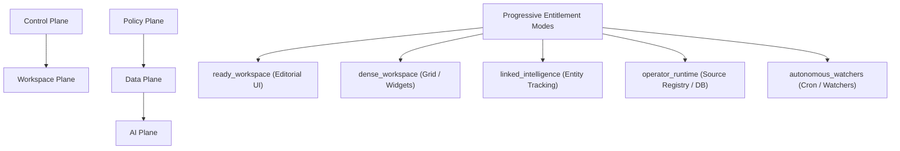

# Project Strategy: Governed Autonomous Intelligence Workspace (v3.0)

**Status:** Unified Source of Truth | Language: EN | Format: Telegraphic Markdown | Last: 2026-06-02

---

## 1. Product Philosophy & Market Positioning

1. **Decision-First Analytics**: Not passive BI. Generate actionable briefs, anomaly alerts, and evidence-backed OSINT reports for media and risk analysis.
2. **Deep Topic, Not Universal Oracle**: The system does not need to know everything well. It must learn one bounded topic deeply for one customer, then operate quickly over evidence, probabilities, correlations, anomalies, and caveats.
3. **Anti-Fatigue Design**: Minimize cognitive load. Prefer contextual warnings, progress bars, and caveat flags over crowded scatter plots.
4. **Local-First, Cloud DR**: SQLite with WAL enabled (MacBook Pro M4, 18k+ videos) as primary. Neon Postgres + Kaggle SDK as async backup/sync.
5. **Target ICP Hierarchy**:
   - *Primary*: News & political media teams (high feed density, time-sensitive briefings).
   - *Secondary*: OSINT, public affairs, and info-risk investigation teams.
   - *Tertiary*: PR agencies, crisis communication, and political consulting teams.

---

## 2. Product Architecture & Progressive Entitlements

The workspace is structured into five core Planes and five progressive Entitlement Modes:

### 2.1 Core Architectural Planes
- **Control Plane**: Granular admin-session token auth (`_admin_required`), health endpoints, and system daemon shutdown controls.
- **Data Plane**: Local SQLite WAL, Neon cloud sync, source records registry, and evidence link mapping.
- **Workspace Plane**: Dense resizable SPA grids, Gray-scale UI themes, local-storage state persistence, and sidebar click-outside auto-closures.
- **AI Plane**: Model provider quota rotation, OpenRouter free-model coercion, and streaming SSE responses.
- **Policy Plane**: Source policy tiers validation, user actions audit logging, and credentials access boundaries.

### 2.2 Ingestion Source Policy Tiers
- **Tier A**: Official APIs & permits (allow with quota enforcement).
- **Tier B**: Licensed, research, or partner feeds (allow with contract compliance).
- **Tier C**: Owned, manual uploads, and RSS feeds (allow with ownership disclaimer).
- **Tier D**: Managed collection vendors with built-in governance (allow after vendor review).
- **Tier E**: Custom scrapers (disabled by default; requires explicit administrator whitelist).
- **Tier X**: Prohibited or high-risk collection sources (permanently blocked).

---

## 3. Memory OS & RAG Architecture

Memory OS serves as an agent-centric RAG and developer context tool. The visual metrics dashboard is deprioritized; instead, a detailed CLI-first interface (optimized for agent context injection) is the primary target. For advanced visual monitoring or configuration, external tools (e.g. Open WebUI) or advanced CLI utilities (like Claude Code) are preferred over proprietary dashboard UI widgets.

### 3.1 Developer Memory OS (Dev-OS)
To bypass LLM attention bottlenecks and optimize token budgets for development, Dev-OS uses a 3-layer schema:
- **Layer 1: Root Map (`llms.txt`)**: Curated index of entry points, routes, blueprints, and core service components.
- **Layer 2: Memory Nodes (`memory_snapshot.json`)**: Automatic index mapping file paths, SHA-256 hashes, class/function exports, and direct dependencies.
- **Layer 3: Experience Log (`task_capsules.jsonl`)**: Chronological ledger recording completed tasks, regressions, resolution steps, and lessons learned.

#### 3.1.1 Hybrid Context Routing
- **Symbolic Router**: Leverages exact class/function symbols and imports indexes for immediate code retrieval.
- **Semantic Router**: Uses vector representation queries for conceptual questions (e.g., fallback chain behavior).
- **Dependency Router**: Audits import graphs to pull all files within the blast radius of any planned code edits.

#### 3.1.2 OS-Inspired Operating Rules
- **Hierarchical Memory**: Load L0/L1 rules first, then root maps, then module maps, then exact evidence. Never load raw history by default.
- **Addressable Memory**: Treat memory as nodes, edges, events, symbols, and manifests, not anonymous chunks.
- **Process Isolation**: Worker agents may inspect untrusted files, logs, pages, and tool outputs; main reasoning consumes schema-validated summaries.
- **Journaling**: Durable memory changes must move from observed/proposed to validated/committed/superseded with evidence pointers.
- **Scheduler Policy**: Repeated deterministic tasks become scripts or tools. Data analysis prefers Python/SQLite/Numpy over free-form LLM reasoning.
- **Verification Pattern**: Claims about code, data, or source behavior need evidence pointers plus deterministic validators before becoming trusted memory.

### 3.2 User-Facing Memory OS (User-OS)
Integrated within the product's chat assistant to enable the end-user (analyst, media editor) to customize their assistant:
- **Scope**: Facts about monitored news channels, narrative trends, topic entities, custom alerts, user preferences, and dashboard metrics.
- **Zero Codebase Leakage**: Strictly excludes all product codebase knowledge (blueprints, source files, symbols, developer logs).
- **Storage Layer**: Database-backed SQLite database (`data/memory_os.db` in `memories` table), completely isolated from the developer's flat-file JSONL structures.
- **Extraction Flow**: Users feed dashboard widget metrics (anomalies, briefs, phrase growth scores) to teach the assistant.
- **User Memory Graph**: Captures user-defined narrative relationships (nodes, edges) to track evolving news domains.

### 3.3 Deep Topic Study Contract
- Unit of work: one customer, one topic, one bounded corpus.
- Required outputs: evidence rows, probability-like signals, correlations, anomalies, caveats, and confidence score.
- Default implementation: `python -m scripts.analytics topic-study --customer <name> --topic <query>`.
- LLM role: interpret and brief after deterministic analysis, not replace the analysis.

### 3.4 Data Access Experiment Loop
- The OS must actively search for permitted ways to read data: official APIs, licensed feeds, RSS, manual files, existing local logs, and explicitly approved scraper paths.
- Slow, partial, or experimental methods are allowed during exploration if they stay inside source policy and resource limits.
- Every method run should write a structured experiment log with method id, source type, policy tier, outcome, records read, duration, errors, bytes, and cost estimate.
- Periodic analysis ranks methods by success rate, throughput, cost, errors, and sample confidence.
- Reliable methods graduate into reusable connectors/functions; weak methods are retried, constrained, or retired.

---

## 4. AI Behavioral Contract

### 4.1 Autonomy Boundaries
- **Full Autonomy (Execute Directly)**: Click commands, optimization scripts, SQL index additions, deterministic analytics math, and local unit test checks.
- **Strategic Approval (Ask First)**: DB schema mutations, remote sync configurations, new library installations, threading locks, and core monolith refactors.
- **UI/UX Consultation (Strict Mockups)**: DOM structural changes, stylesheet rules edits, adaptive columns stacking, and viewport resizing offsets.
- **Owner Intervention**: The Owner retains the full right to intervene in the details of any workflow pipeline step (including options selection, plans, implementation details, or testing) where they possess specific expertise.

### 4.2 LLM Budget Tiers
- Canonical routing lives in `agent_context/WORKFLOWS.md`.
- Two workflows: `product` for customer-facing workspace, `memos` for Memory OS and development intelligence.
- Step scale: 1-12 from `nano` to `giant`; older `tiny/mid/giant` commands map into this scale.

### 4.3 Global Response Language Policy
- **User Correspondence**: Always respond to the user in the language they address you in (e.g. Ukrainian, English, Spanish, Portuguese, Turkish).
- **Russian Language Gating**: Never generate or respond in the Russian language. If addressed in Russian, always respond in a different random language (e.g. English, Ukrainian).
- **Internal Standard**: All internal files, documentation, code comments, and database structures must remain in token-optimized English as per strategy.

---

## 5. Security & Secret Management

- **Secrets Isolation**: Never log, echo, print, or reference values from `.env` (API keys, DB URLs) in code, telemetry, or documentation.
- **Redaction Contract**:
  - API list responses must exclude `metadata_json` or raw outputs text.
  - Source credentials check must omit the `secret_ref` field, returning only Boolean flags indicating presence.
  - Audit logs must redact actor metadata details.

---

## 6. Locked Technical Stack

- **Backend**: Python 3.9+, Flask (blueprints factory), SQLite (9 indexes, WAL mode), Neon Postgres (async DR sync).
- **Frontend**: HTML5/CSS3 (Vanilla Gray-scale themes, backdrop filters, responsive grid), localStorage (UI state), ES modules.
- **CLI**: Click CLI, yt-dlp wrapper, Kaggle SDK, psycopg2 connection pool.
- **Infrastructure**: Virtual environment (`venv_auto/`), subprocess task isolation, threading daemon metrics collector.
